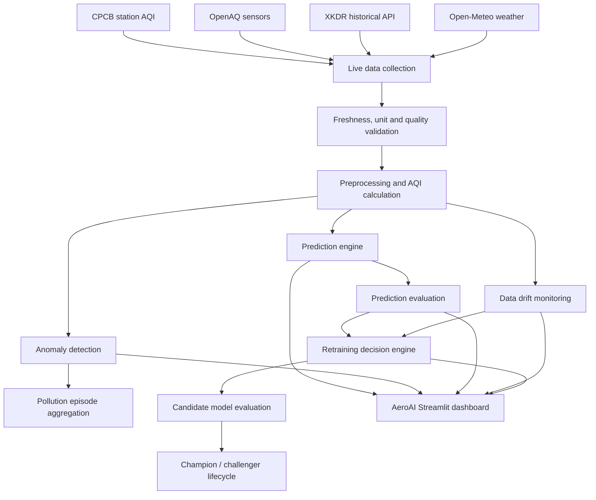

# 🌿 AeroAI — AI-Enabled Air Quality Intelligence Platform

AeroAI is an academic machine-learning project focused on air-quality monitoring, AQI estimation, next-day forecasting, anomaly detection, model monitoring, and controlled model retraining.

**Project location:** Doon University, Dehradun, Uttarakhand, India.

## Project objectives

- Retrieve air-quality observations from multiple data sources.
- Display current CPCB station AQI and pollutant measurements.
- Calculate AQI using CPCB breakpoint and averaging methodology where the required data is available.
- Build next-day AQI forecasting models.
- Detect unusual pollution patterns and potential pollution episodes.
- Monitor feature drift and forecast performance.
- Evaluate candidate models before any champion replacement.
- Provide an interactive Streamlit dashboard and MLflow experiment tracking.

## Architecture



## Data sources

| Source | Purpose | Notes |
|---|---|---|
| CPCB data published through data.gov.in | Current station AQI | Official station AQI is displayed separately from calculated estimates |
| OpenAQ API v3 | Hourly and latest sensor measurements | Original measurements and units are retained |
| XKDR Air Quality API | Historical daily and hourly observations | Feed freshness must be checked before use |
| Open-Meteo | Weather information | Weather-model data is not a ground-station pollutant measurement |

### Monitoring station

- Station: Doon University, Dehradun - UKPCB
- XKDR station ID: `site_5594`
- OpenAQ location ID: `317035`
- Coordinates: 30.269444, 78.044167

### Source attribution

CPCB station information is retrieved through the India Air Quality API, which attributes the underlying monitoring data to CPCB and data.gov.in. The relevant data.gov.in resource is:

https://www.data.gov.in/resource/3b01bcb8-0b14-4abf-b6f2-c1bfd384ba69

OpenAQ source:

https://explore.openaq.org/locations/317035

XKDR source:

https://airquality.xkdr.org/

Open-Meteo source:

https://open-meteo.com/

Do not redistribute third-party datasets without checking their applicable licences and redistribution terms. Runtime datasets are intentionally excluded from this repository.

## Current implementation

### Live monitoring

- Current CPCB station AQI snapshot.
- Station category, update time, freshness and pollutant sub-indices.
- Nearby CPCB stations.
- OpenAQ latest sensor measurements.
- Weather information through Open-Meteo.

### Historical data processing

- Daily and hourly XKDR collection.
- Separate OpenAQ historical hourly collector.
- Timestamp alignment and duplicate checks.
- Unit validation and missing-data reporting.
- Hourly rolling AQI calculations.
- Separate monitoring and quality reports.

### AQI calculation

The shared AQI calculator implements pollutant breakpoints and hourly averaging rules.

The hourly calculation uses:
- Trailing 24-hour averages for 24-hour pollutants.
- Maximum trailing 8-hour averages for CO and Ozone.
- Minimum valid-hour requirements.
- Minimum pollutant-count and particulate-matter requirements.

**Important:** An AQI calculated from OpenAQ sensor observations using CPCB methodology is a CPCB-method estimate, not an official CPCB station AQI. The dashboard and reports must keep these values clearly separated.

Daily calculations with unverified hourly coverage must not be represented as fully validated official CPCB AQI.

### Machine learning

- Random Forest regression.
- XGBoost regression.
- Chronological train/test splitting.
- Next-day target construction.
- Persistence baseline evaluation.
- MLflow experiment tracking.
- Separate CPCB candidate-model artifacts.

The active legacy model predicts `Next-day estimated AQI`. It must not be described as an official CPCB AQI forecasting model.

The CPCB candidate is experimental and has not been promoted. Recorded candidate results were not better than the persistence baseline.

### Monitoring and adaptive intelligence

- Population Stability Index (PSI) feature drift monitoring.
- Prediction history and actual-outcome evaluation.
- Robust hourly anomaly detection.
- Pollution episode aggregation.
- Retraining readiness and labelled-data checks.
- Guarded candidate training and model lifecycle logic.

Automatic model replacement is disabled unless the required champion/target compatibility and validation conditions are met.

## Project structure

```text
AQI-AI-Project/
├── app.py
├── train_model.py
├── best_aqi_model.pkl
├── model_results.json
├── requirements.txt
├── .env.example
├── .gitignore
├── README.md
├── data/
│   └── README.md
├── models/
│   └── cpcb_candidate_results.json
├── src/
│   ├── aqi_calculator.py
│   ├── data_collection.py
│   ├── preprocessing.py
│   ├── hourly_data_collection.py
│   ├── hourly_preprocessing.py
│   ├── live_air_quality.py
│   ├── openaq_data.py
│   ├── openaq_daily_collection.py
│   ├── openaq_hourly_collection.py
│   ├── openaq_aqi_processing.py
│   ├── weather_data.py
│   ├── prediction.py
│   ├── drift_detection.py
│   ├── model_monitoring.py
│   ├── hourly_anomaly_detection.py
│   ├── anomaly_event_aggregator.py
│   ├── retraining_decision_engine.py
│   ├── intelligent_retraining.py
│   └── run_pipeline.py
└── tests/
    ├── test_collection_pipeline.py
    ├── test_pipeline_components.py
    └── test_prediction_monitoring.py
```

Runtime datasets, snapshots, logs, local credentials, MLflow databases and virtual environments are not committed.

## Requirements

- Python 3.12
- pip
- Git
- XKDR API key for XKDR collection
- OpenAQ API key for OpenAQ collection
- Internet connection for live source retrieval

On Apple Silicon macOS, install OpenMP if XGBoost reports a missing OpenMP library:

```bash
brew install libomp
```

## Installation

Clone the repository:

```bash
git clone https://github.com/DevankSilswal/AeroAI.git
cd AeroAI
```

Create a virtual environment:

```bash
python3.12 -m venv venv
source venv/bin/activate
```

Install dependencies:

```bash
pip install -r requirements.txt
```

Create a local `.env` file:

```bash
cp .env.example .env
```

Add your own API credentials to `.env`:

```text
AQI_API_KEY=your_xkdr_api_key
OPENAQ_API_KEY=your_openaq_api_key
```

Never commit `.env` or share API keys.

## Run AeroAI

Start the dashboard:

```bash
streamlit run app.py
```

Run the integrated pipeline:

```bash
python src/run_pipeline.py
```

Collect OpenAQ historical hourly measurements:

```bash
python src/openaq_hourly_collection.py
```

Run the separate OpenAQ AQI processing module:

```bash
python src/openaq_aqi_processing.py
```

Train/evaluate the configured candidate models:

```bash
python train_model.py
```

Run the automated tests:

```bash
python -m unittest discover -s tests -v
```

Launch the local MLflow interface:

```bash
mlflow ui --backend-store-uri sqlite:///mlflow.db --host 127.0.0.1 --port 5000
```

Open http://127.0.0.1:5000 in a browser.

## Recorded validation snapshot — 27 November 2026

The following results were observed during project development:

- CPCB station snapshot: AQI 104, Moderate, with a fresh station update at the time of collection.
- OpenAQ live collector: 12 of 12 sensor readings were fresh at the recorded check.
- XKDR daily and hourly feeds still returned observations ending on 8 November 2026; the integrated pipeline correctly marked those feeds stale during the 27 November validation.
- Next-day prediction was blocked by the 48-hour freshness gate. No new forecast was generated from the stale XKDR input.
- OpenAQ historical hourly collection retrieved 18,371 long-form records across five parameters.
- The corresponding wide dataset contained 4,319 hourly time slots.
- A separate validation calculated 3,526 valid CPCB-method AQI hours (81.64% coverage) from the available OpenAQ PM2.5, PM10 and Ozone measurements.
- That OpenAQ-derived AQI is an estimate and is not an official CPCB station AQI.
- The most recent recorded automated test run contained 21 passing tests. API and orchestration tests include mocks and do not replace live integration testing.

These are dated development observations, not guarantees of current API availability or future model accuracy.

## Current limitations and work in progress

- The legacy XKDR feed may return historical data rather than recent observations.
- The current legacy prediction model cannot be treated as a CPCB-target model.
- OpenAQ NO2, SO2 and CO unit/scale compatibility requires further verification before model use.
- OpenAQ historical data integrity and AQI processing require continuing validation.
- A reliable next-day CPCB-target forecasting model has not yet been established.
- Event-aware features for Diwali and other local events are not yet implemented.
- Temporary pollution events and persistent model degradation need further separation.
- Automatic champion promotion and rollback require end-to-end validation.
- Some monitoring modules still need stronger protection against stale upstream datasets.

## Privacy and repository contents

The repository intentionally excludes:
- `.env` and API credentials.
- Virtual environments and Python caches.
- Local MLflow databases and run artifacts.
- Generated sensor datasets and monitoring snapshots.
- Local logs and temporary backup source files.

The active model artifact and its metadata are included. Pickle/joblib model files should only be loaded from trusted sources.

## Academic project

**Project title:** Design and Implement an AI-Enabled Automated Pipeline for Air Quality Index Prediction, Model Monitoring, and Intelligent Retraining.

**Platform:** AeroAI — Air Quality Intelligence Platform.

This repository documents an academic prototype and its ongoing development. It does not claim that every planned autonomous capability is production-ready.
